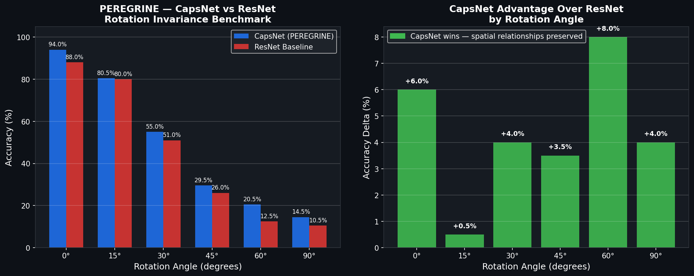

# 🦅 PEREGRINE — Aerospace Object Detection System
### Edge-Deployed Capsule Network for Spatial Reasoning in Defense Imagery
### CapsNet vs ResNet — 68,000 Real Aerial Images — NVIDIA Jetson Orin

[](https://python.org)
[](https://pytorch.org)
[](https://mlflow.org)
[](https://onnx.ai)
[](LICENSE)
[](https://github.com/Robair26/PEREGRINE/actions)

---

## 🎯 What is PEREGRINE?

PEREGRINE is an aerospace object detection system built on Geoffrey Hinton's Capsule Network architecture (2017). It implements dynamic routing by agreement from scratch in PyTorch, trains on 68,000 real satellite and aerial images from the DIOR dataset, and deploys on an NVIDIA Jetson Orin Nano for sub-3ms edge inference with no cloud required for inference.

PEREGRINE tests a hypothesis: capsule networks preserve spatial relationships that CNNs lose through max-pooling, which may make them more robust to rotation in aerospace and defense imagery, where objects appear at arbitrary orientations.

The system is deployed on an NVIDIA Jetson Orin Nano for edge inference, tracked with MLflow, monitored with Prometheus and Grafana, orchestrated with Kubernetes (K3s), and served through a live FastAPI inference endpoint. It also includes an autonomous investigation agent that generates structured incident reports.

Named after the Peregrine falcon — the fastest animal alive, known for extraordinary spatial perception and precision targeting from altitude.

---

## 🌐 Live Demo

**Try it now — upload any satellite or aerial image:**
**https://peregrine.bitshadow.dev**

API documentation: https://peregrine.bitshadow.dev/docs

---

## 📊 Full Training Results — NVIDIA Jetson Orin

### Overall Accuracy — 68,000 Real Aerial Images, 15 Epochs

| Model | Test Accuracy | Parameters | Edge Inference |
|-------|--------------|------------|----------------|
| CapsNet (PEREGRINE) | 82.99% | 3,056,448 | 2.65ms |
| ResNet Baseline | 89.97% | 2,780,244 | — |

ResNet achieves higher overall accuracy on this dataset.

### Rotation Benchmark

| Rotation | CapsNet | ResNet | CapsNet Advantage |
|----------|---------|--------|-------------------|
| 0° | 94.0% | 88.0% | +6.0% |
| 15° | 80.5% | 80.0% | +0.5% |
| 30° | 55.0% | 51.0% | +4.0% |
| 45° | 29.5% | 26.0% | +3.5% |
| 60° | 20.5% | 12.5% | +8.0% |
| 90° | 14.5% | 10.5% | +4.0% |

CapsNet scored higher than ResNet at all 6 angles. The largest gap is +8.0 points at 60°. Results come from a single run on a small test subset, so small gaps (such as +0.5 at 15°) should not be over-interpreted. Both models lose most of their accuracy at large rotations.



### Per-Class Accuracy on Aerospace Objects

| Class | CapsNet | ResNet |
|-------|---------|--------|
| Vehicle | **94.4%** | 93.6% |
| Tennis Court | **90.7%** | 88.1% |
| Ship | 88.2% | 89.4% |
| Airplane | 83.0% | 89.5% |
| Baseball Field | **85.0%** | 84.0% |
| Harbor | 65.6% | 69.8% |
| Bridge | 40.8% | 54.1% |
| Dam | 32.5% | 83.6% |

---

## 🧠 The Research Finding

ResNet achieves higher overall classification accuracy on DIOR. In the rotation tests, CapsNet lost less accuracy than ResNet under rotation: it scored higher at every angle tested, with the largest gap at 60°. The gap is not steady across angles, and both models degrade sharply at large rotations. This matters for aerospace and defense applications, where satellite imagery captures objects at arbitrary orientations, drone footage shows vehicles and aircraft banking and turning, and cluttered aerial scenes have overlapping, spatially complex objects.

CapsNet's dynamic routing by agreement is designed to preserve orientation, pose, and spatial relationships between features, which CNNs can lose through max-pooling.

### Why CapsNet over Vision Transformers?

ViTs achieve state-of-the-art accuracy but require massive datasets and compute. CapsNet's inductive spatial bias may make it more data-efficient and deployable on edge hardware — a 12.2MB ONNX model running at 2.65ms on Jetson Orin Nano with no cloud dependency for inference. For field operations where connectivity is limited and latency is critical, edge-deployable spatial reasoning is a practical advantage over cloud-dependent accuracy.

---

## 🏗️ Architecture

```
EDGE LAYER — NVIDIA Jetson Orin Nano
ONNX Runtime · 2.65ms inference · 12.2MB model · No cloud required for inference

CLOUD LAYER — AWS + DigitalOcean
Model registry · Retraining pipeline · S3 artifacts

ORCHESTRATION — Kubernetes K3s
Auto-healing · Prometheus · Grafana monitoring

MLOPS — MLflow
Experiment tracking · Model versioning · Drift detection · KS-test statistical monitoring

AGENT LAYER — Autonomous Investigation
Threat assessment · Severity classification · Incident reports · Recommended actions
```

CapsNet Architecture:

```
Input Image (3ch, 32x32, resized from DIOR images)
    ↓
Conv Layer (64 filters, 5x5, ReLU)
    ↓
Primary Capsules (8 types, 8D vectors, squash activation)
    ↓
Dynamic Routing by Agreement
    ↓
Class Capsules (16D vectors x 20 aerospace classes)
    ↓
Vector Length to Class Probability
```

---

## ✅ Complete Feature List

**CapsNet Implementation** — Dynamic routing by agreement implemented from scratch in PyTorch following the 2017 paper: primary capsules, class capsules, squash activation, and margin loss.

**ResNet Baseline** — Lightweight ResNet with residual blocks for direct benchmark comparison on rotated imagery.

**Full DIOR Training** — 68,000 real satellite and aerial images across 20 object classes, trained on NVIDIA Jetson Orin. Ships, aircraft, vehicles, airports, bridges, dams, harbors, and more.

**Rotation Benchmark** — Tests both models at 0, 15, 30, 45, 60, and 90 degree rotation. CapsNet scores higher at all six angles in a single run; the gap is largest at 60°.

**ONNX Edge Export** — 12.2MB model exported to ONNX and running at 2.65ms on Jetson Orin Nano, with no cloud dependency for inference.

**MLflow Experiment Tracking** — Every training run, parameter, and metric logged automatically, with model registry and artifact storage.

**Live Dashboard** — Web interface at peregrine.bitshadow.dev. Upload any satellite or aerial image and see detections with confidence scores, top 5 results, agent assessment, and live detection distribution.

**FastAPI Inference Endpoint** — Live API accepting satellite images and returning detections with confidence scores for all 20 aerospace classes. Full OpenAPI documentation.

**Autonomous Investigation Agent** — Detects objects, assesses threat severity (HIGH/MEDIUM/LOW), generates contextual assessments, recommends actions, and saves structured JSON incident reports. Every detection is logged.

**Prometheus Metrics** — Inference latency, detection counters by class, confidence score tracking, and request rate monitoring, exposed at the /metrics endpoint.

**Grafana Dashboard** — Live detection monitor showing total detections, inference latency gauge, confidence score, requests per minute, and detections by class. Auto-refreshes every 5 seconds.

**Drift Detection** — Statistical monitoring using KS-test on confidence score and entropy distributions. Detects data distribution shift, class imbalance, and low-confidence degradation. SQLite audit log for all drift alerts.

**Kubernetes Orchestration** — K3s lightweight cluster with auto-healing deployments and persistent volume claims.

**CI/CD Pipeline** — GitHub Actions automated testing on every push. Tests CapsNet, ResNet, and MNIST backward compatibility.

---

## 🛠️ Tech Stack

| Layer | Technology |
|-------|-----------|
| Model | PyTorch 2.8.0 — CapsNet + ResNet from scratch |
| Dataset | DIOR — 68,000 aerial images, 20 object classes |
| Experiment Tracking | MLflow 3.12 — experiment registry |
| Edge Device | NVIDIA Jetson Orin Nano — ARM aarch64 |
| Edge Inference | ONNX Runtime — 2.65ms, 12.2MB model |
| Monitoring | Prometheus + Grafana — live inference metrics |
| Drift Detection | KS-test + PSI scoring + SQLite audit log |
| Agent | Threat assessment + incident reports |
| Orchestration | Docker + Kubernetes K3s |
| API | FastAPI + Uvicorn |
| CI/CD | GitHub Actions |
| Cloud | AWS S3 + DigitalOcean |
| Language | Python 3.10 |

---

## 📁 Project Structure

```
PEREGRINE/
├── src/
│   ├── models/
│   │   ├── capsnet.py              # CapsNet — Hinton 2017 dynamic routing
│   │   └── resnet_baseline.py      # ResNet benchmark baseline
│   ├── data/
│   │   └── dior_dataloader.py      # DIOR aerial dataset pipeline
│   ├── api.py                      # FastAPI inference + metrics + agent endpoints
│   ├── agent.py                    # Autonomous investigation agent
│   ├── drift_detection.py          # KS-test drift monitoring + SQLite audit
│   ├── train.py                    # MNIST smoke test training
│   ├── train_jetson.py             # Full DIOR training on Jetson
│   ├── benchmark.py                # CapsNet vs ResNet comparison
│   ├── rotation_test.py            # Rotation benchmark
│   ├── visualize.py                # Benchmark visualization
│   └── export_onnx.py              # ONNX edge export
├── frontend/
│   └── index.html                  # Live dashboard
├── docs/
│   └── rotation_benchmark.png      # Results chart
├── deploy/
│   └── prometheus.yml              # Monitoring config
├── reports/                        # Agent incident reports (JSON)
├── .github/workflows/ci.yml        # GitHub Actions CI
├── Dockerfile
├── docker-compose.yml
├── requirements.txt
└── README.md
```

---

## 🚀 Quickstart

Download the DIOR dataset from its official release and point `src/data/dior_dataloader.py` at the data directory.

```bash
git clone https://github.com/Robair26/PEREGRINE.git
cd PEREGRINE
python3 -m venv peregrine-env
source peregrine-env/bin/activate
pip install torch torchvision mlflow scikit-learn tqdm matplotlib fastapi uvicorn python-multipart scipy prometheus-client
python src/benchmark.py
python src/rotation_test.py
python src/api.py
python src/agent.py
python src/drift_detection.py
mlflow ui --backend-store-uri sqlite:///mlflow.db
docker build -t peregrine .
docker-compose up
```

---

## 📈 Roadmap

- [x] CapsNet implementation — Hinton 2017 dynamic routing by agreement
- [x] ResNet baseline for benchmark comparison
- [x] Training loop with margin loss
- [x] MLflow experiment tracking and model registry
- [x] Rotation benchmark — CapsNet scores higher at 6/6 angles (single run)
- [x] DIOR aerial dataset — 68,000 real aerospace images
- [x] Full training on NVIDIA Jetson Orin — 15 epochs
- [x] ONNX export — 12.2MB model, 2.65ms edge inference
- [x] FastAPI inference endpoint
- [x] Live dashboard — peregrine.bitshadow.dev
- [x] Docker + Kubernetes deployment
- [x] GitHub Actions CI
- [x] Prometheus metrics — inference latency, detection counts, confidence
- [x] Grafana live monitoring dashboard — auto-refresh every 5s
- [x] Drift detection — KS-test, class imbalance, SQLite audit log
- [x] Autonomous investigation agent — threat assessment, incident reports
- [ ] Multiple training runs with confidence intervals
- [ ] Research paper writeup

---

## 📚 Research Foundation

- Sabour, Frosst, Hinton — Dynamic Routing Between Capsules (2017)
- Hinton, Sabour, Frosst — Matrix Capsules with EM Routing (2018)
- He et al. — Deep Residual Learning for Image Recognition (2015)
- Li et al. — Object Detection in Optical Remote Sensing Images (2020)
- Cheng et al. — Capsule Networks for Remote Sensing (2021)

---

## 👤 Built By

Robair Farag — M.S. Applied Artificial Intelligence, University of San Diego

- Live demo: https://peregrine.bitshadow.dev
- AXIOM (edge-cloud AI system): https://axiom.bitshadow.dev
- GitHub: https://github.com/Robair26
- PEREGRINE: https://github.com/Robair26/PEREGRINE
